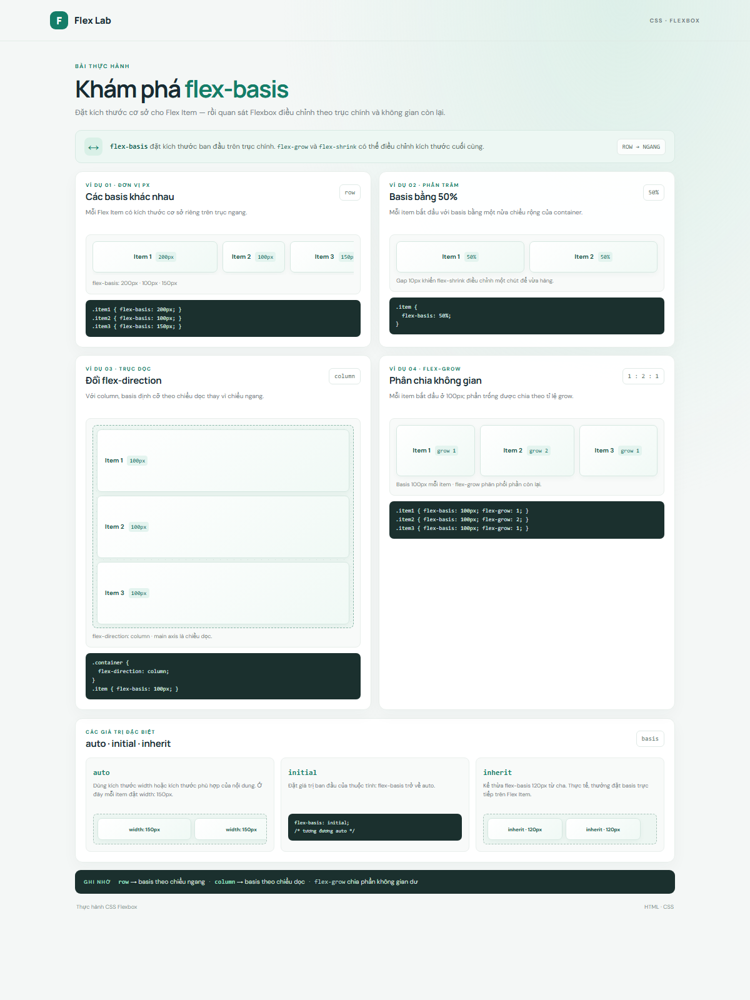

# CSS Flexbox: `flex-basis`

Bài thực hành minh họa các ví dụ `flex-basis` theo đơn vị px và %, cách basis thay đổi theo `flex-direction`, cách phối hợp với `flex-grow`, cùng các giá trị `auto`, `initial` và `inherit`.

## Chạy bài

Mở `index.html` trong trình duyệt. Không cần cài đặt thư viện hay công cụ build.

## Ảnh kết quả

